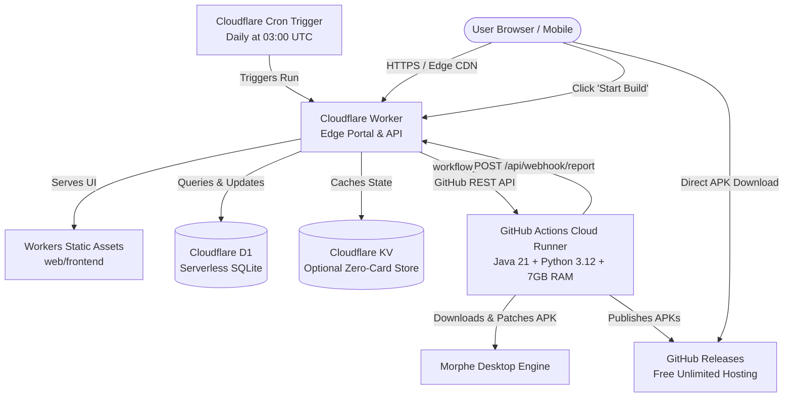

[🏠 Documentation Hub](README.md) › **Cloudflare Workers Free Tier Setup Guide**

---

# ☁️ Cloudflare Workers Deployment Guide (100% Free Tier)

Deploy AutoMorph as a **serverless edge management portal and build distribution hub** directly on **Cloudflare Workers**, modeled after **[NodeWarden](https://github.com/shuaiplus/nodewarden)**.

This deployment method runs **100% within the Cloudflare Free Plan** and requires **zero credit card**:
* 🌐 **Global Edge Control Center**: Hosts the AutoMorph Web Portal and REST/SSE management API on Cloudflare's edge network with ultra-low latency and DDoS protection.
* 💾 **Serverless SQLite (Cloudflare D1)**: Stores package configs, patch aliases, options, execution logs, and metrics (5 million reads/day and 100,000 writes/day free).
* 🔑 **Zero-Card Key-Value Fallback (Cloudflare KV)**: Optional 1 GB free KV namespace for caching and state without requiring billing or payment information.
* ⏰ **Automated Daily Scheduling**: Cloudflare Workers Cron Triggers (`0 3 * * *`) fire daily builds automatically.
* ⚡ **Serverless Cloud Patch Runner**: Automatically dispatches heavy APK patching tasks (Java 21 + Python + Morphe) to GitHub Actions free runners (unlimited minutes on public repos, 2,000 min/mo on private repos), releases builds, and syncs live metrics back to your Cloudflare dashboard.

---

## 🏗️ Architecture & Mental Model



---

## 📊 Dashboard Metric Mapping & Free Tier Quotas

AutoMorph's web interface displays 6 primary metric categories. Here is how each metric maps to the Cloudflare Workers Free Tier:

| Metric Card | Source in Docker | Cloudflare Free Tier Implementation | Free Tier Allowance & Safety |
| :--- | :--- | :--- | :--- |
| **System Status** (`is_running`, `active_run`) | `runner.is_running` & file lock `state/lock.json` | Stored in D1 `state` table (`active_lock`) with expiration TTL | **100k requests/day**: Lock is checked on status queries (<1ms CPU in V8 isolate). |
| **Next Run Countdown** (`stat-next-run`) | In-memory `resolve_schedule_target()` | Calculated in Worker `router.ts` from D1 `schedule_time` + `timezone` against Cloudflare Cron Trigger | **0 database cost**: Computed on-the-fly in Worker memory (<0.1ms CPU). |
| **Last Run Status & Duration** (`stat-last-status`) | `tools/automorph-data/state/logs/last_run.json` | Queried from D1 `run_history` table (`ORDER BY finished_at DESC LIMIT 1`) | **5M row reads/day**: Single indexed SQLite lookup; well within free quotas. |
| **Storage Stats** (`stat-storage-size`, `stat-apk-count`) | Local disk scan of `apps/patched/` and `patched.json` | SQL aggregation in D1: `SELECT COUNT(*), SUM(size_bytes) FROM patched_apps` | **Fast SQLite Index**: Real-time aggregation of ready APK files and total bytes. |
| **Configured Totals** (`stat-apps-count`, `stat-repos-count`) | `len(config['packages'])` & distinct repos | Queried from D1 `packages` table and `patch_repos` JSON list | **5 GB Storage**: Minimal storage footprint (<100 KB for thousands of apps). |
| **App Version & Updates** (`site-version-val`) | `web/version.json` & GitHub Releases API | Served from Workers Static Assets and queried with ETag caching | **Unlimited Static Requests**: Zero quota cost for serving frontend assets. |
| **Execution Logs & Reports** (`/api/run/logs`, `/report`) | `last_run.log` & `build_report.html` | Stored in D1 `run_logs` and `config.latest_report_html` (pruned to `max_logs`) | **Automatic Pruning**: Keeps DB size under 500MB per database limit. |

---

## 🚀 Deployment Options

### Method A: 1-Click Git Integration via Cloudflare Dashboard (Recommended)

1. **Fork the AutoMorph Repository** to your GitHub account.
2. Open the [Cloudflare Dashboard](https://dash.cloudflare.com/) and navigate to **Workers & Pages** > **Create**.
3. Select **Continue with GitHub** and authorize your fork.
4. Configure the build and deployment settings:
   * **Project name**: `automorph`
   * **Framework preset**: `None`
   * **Build command**: `npm run build`
   * **Deploy command**: `npm run deploy` *(or `npm run deploy:kv` for zero-card KV mode)*
5. **Create the D1 Database**:
   * In the Cloudflare Dashboard, go to **Storage & Databases** > **D1** > **Create Database**.
   * Name it `automorph-db`.
   * Under your Worker's **Settings** > **Bindings**, add a **D1 Database Binding**:
     * **Variable name**: `DB`
     * **D1 database**: Select `automorph-db`.
6. **Configure Secrets & Variables** under **Settings** > **Variables and Secrets**:
   * `GITHUB_REPO`: `your-username/AutoMorph` (your forked repository).
   * `GITHUB_TOKEN`: A GitHub Personal Access Token (classic with `repo` scope, or fine-grained with Actions + Contents read/write permissions) to allow the Worker to trigger cloud builds.
   * `WEBHOOK_SECRET`: A secure random password of your choice (e.g. 32 characters) to authenticate build reports from the runner.
7. Click **Deploy**. Your AutoMorph portal will be live at `https://automorph.<your-subdomain>.workers.dev`!

---

### Method B: Deploy using Wrangler CLI

If you prefer deploying from your local terminal:

1. **Clone your repository**:
   ```bash
   git clone https://github.com/your-username/AutoMorph.git
   cd AutoMorph
   ```

2. **Install Node dependencies**:
   ```bash
   npm install
   ```

3. **Authenticate Wrangler with Cloudflare**:
   ```bash
   npx wrangler login
   ```

4. **Create your free D1 Database**:
   ```bash
   npx wrangler d1 create automorph-db
   ```
   *Copy the generated `database_id` into `wrangler.toml` if prompted.*

5. **Apply database migrations**:
   ```bash
   npx wrangler d1 migrations apply automorph-db --remote
   ```

6. **Set your Worker secrets**:
   ```bash
   npx wrangler secret put GITHUB_TOKEN
   npx wrangler secret put GITHUB_REPO
   npx wrangler secret put WEBHOOK_SECRET
   ```

7. **Deploy to Cloudflare Workers**:
   * Standard D1 mode:
     ```bash
     npm run deploy
     ```
   * Zero-card KV mode (matches NodeWarden):
     ```bash
     npm run deploy:kv
     ```

---

## ⚙️ Setting Up the GitHub Actions Cloud Runner

When you trigger a build through the web portal or daily schedule, AutoMorph dispatches a job to GitHub Actions to execute the Java/Python patching engine.

In your GitHub repository settings (**Settings** > **Secrets and variables** > **Actions**):
* **`CLOUDFLARE_WORKER_URL`**: Your Cloudflare Worker URL (e.g. `https://automorph.your-name.workers.dev`).
* **`WEBHOOK_SECRET`**: Must match the `WEBHOOK_SECRET` set in your Cloudflare Worker.
* **`GOOPDL_ACCOUNT_EMAIL`** *(Optional)*: Disposable Google account email for Play Store downloads.
* **`GOOPDL_AAS_TOKEN`** *(Optional)*: Google Play AAS token for Play Store downloads.

---

## 🔒 100% Free Tier Limits & Safety

Cloudflare Workers Free Tier includes generous daily allowances that comfortably exceed standard personal patch requirements:
* **Requests**: 100,000 / day (AutoMorph's polling interval uses ~1,000 requests/day for active browser tabs).
* **CPU Time**: 10 ms / request (AutoMorph Worker responses execute in ~0.5 ms to 2 ms).
* **D1 SQLite Reads**: 5,000,000 / day (covers over 50 reads every second).
* **D1 SQLite Writes**: 100,000 / day.
* **D1 Storage**: 5 GB total database storage.
* **Workers Static Assets**: Free and unlimited requests for frontend assets.
* **Cron Triggers**: 3 free scheduled cron triggers per Worker.

---

## 💡 Troubleshooting

<details>
<summary><b>The Worker is deployed but shows "Database not initialized" or 500 error.</b></summary>

Ensure the D1 database binding is named exactly `DB` in your Worker settings (`Settings` > `Bindings` > `D1 Database Bindings`). If applying migrations manually, run:
```bash
npx wrangler d1 migrations apply automorph-db --remote
```
</details>

<details>
<summary><b>Clicking "Start Build" does not launch a patch job.</b></summary>

1. Verify that `GITHUB_TOKEN` and `GITHUB_REPO` are configured in your Worker's environment secrets.
2. Check your GitHub repository's **Actions** tab to confirm that workflow permissions allow `workflow_dispatch`.
3. In GitHub repository **Settings** > **Actions** > **General**, ensure **Workflow permissions** is set to *Read and write permissions*.
</details>

---

[← Previous: Remote Access & Tunnels](tunnels.md) | [Documentation Hub](README.md) | [Next: User Guide →](user-guide.md)
